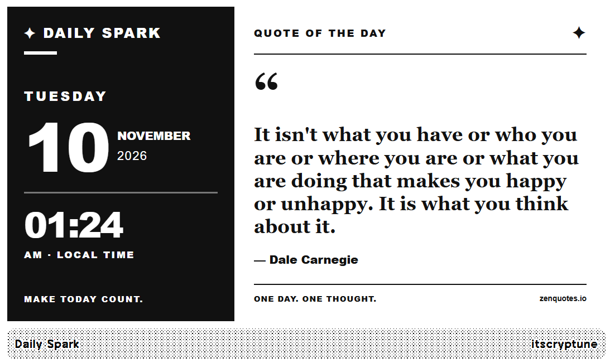

# ✦ Daily Spark — A Daily Quote Dashboard for TRMNL

A simple, personalized daily quote dashboard for TRMNL e-ink displays, featuring a clock, date, motivational quotes, and my own collection of funny and inspiring quotes!

**Made with ❤️ by [Simran (itscryptune)](https://github.com/itscryptune) for Hack Club TRMNT.**

## 👋 Hey, I'm Simran!

Hey! I'm Simran, and this is my first plugin for TRMNL!

My brother has always wanted a TRMNL and has been planning to buy one for some time. Unfortunately, whenever he tries, it seems to be out of stock.

Then I found out about Hack Club and the TRMNT project, and I thought it would be really cool to make something for him as a surprise!

Instead of just getting him a TRMNL, I wanted to build something myself that he could actually use on it.


## 💡 About This Project

I learned programming at school and wanted to try building something real with what I knew.

I decided to use HTML and CSS to create a daily quote generator for a TRMNL e-ink display.

But I didn't want it to be just another random quotes plugin.

I also wanted to include my own custom quotes — things I always say to my brother, sometimes as jokes and sometimes to motivate him.

Now, when he looks at his TRMNL, he might see an inspirational quote from the internet or one of my silly messages!

I thought that would make the surprise much more personal.

While building this project, I also started learning about APIs, JavaScript, Liquid templates, and how TRMNL plugins actually work.


### Screenshot





## 🚀 How to Run Locally

I developed Daily Spark on **Windows 11 using Docker and the official TRMNL Preview tool**.

### Prerequisites

You'll need:

- Docker Desktop
- Git
- VS Code or another code editor


### Step 1 — Clone the Repository

Open PowerShell and run:

```powershell
git clone https://github.com/itscryptune/daily-spark.git
cd daily-spark
```

### Step 2 — Download the TRMNL Preview Docker Image

```powershell
docker pull trmnl/trmnlp
```

### Step 3 — Start the Preview Server

From inside the project folder, run:

```powershell
docker run --rm -it -p 4567:4567 -v "${PWD}:/plugin" trmnl/trmnlp serve --bind 0.0.0.0
```

### Step 4 — Open the Dashboard

Open this address in your browser:

**http://localhost:4567**

You should see the TRMNL Preview interface.

You can inspect the different layouts and test how the dashboard looks on an e-ink display.

### Step 5 — Fetch Quote Data

The plugin uses:

https://zenquotes.io/api/today

Use the preview's polling functionality to fetch the latest quote.

If the API is unavailable, the plugin has fallback content.

## 💬 Adding Your Own Custom Quotes

This is my favorite feature!

I wanted Daily Spark to display jokes and motivational quotes that I personally say to my brother.

All custom quotes are stored in:

`src/transform.js`

Find the `CUSTOM_QUOTES` array.

To add a quote, use this format:

```javascript
{
  text: "Your funny or motivational quote here.",
  author: "itscryptune"
},
```


### Quote Modes

You can also choose which type of quotes appear.

Inside `transform.js`, find:

```javascript
const QUOTE_MODE = "mixed";
```

Available modes:

| Mode | What It Does |
|---|---|
| `custom` | Only displays personal quotes |
| `zen` | Displays quotes from ZenQuotes |
| `mixed` | Mixes personal quotes and ZenQuotes |

When using mixed mode, the percentage of custom quote days can be adjusted with:

```javascript
const CUSTOM_QUOTE_PERCENT = 70;
```

This gives custom quotes approximately 70% of the daily selections.

Quotes are selected using a date-based algorithm, helping keep the quote consistent throughout the day.


### Build the Plugin

```powershell
docker run --rm -v "${PWD}:/plugin" trmnl/trmnlp build
```

### Generate Preview Images

```powershell
docker run --rm -v "${PWD}:/plugin" trmnl/trmnlp build --png
```


## 📚 What I Learned

This project taught me much more than I expected when I started!

Some of the things I learned or practiced include:

- Writing and organizing HTML and CSS.
- Understanding how JavaScript objects and arrays work.
- Fetching data from an external API.
- Working with JSON data.
- Using Liquid templates to display dynamic information.
- Designing layouts for e-ink screens.
- Using Docker to run a local development environment.
- Debugging errors and improving a design.
- Using Git and GitHub to organize a real project.

One interesting challenge was figuring out how to display my custom quotes and internet quotes without showing the wrong author or source.

I also learned that designing for an e-ink screen is different from designing a normal webpage because screen space, contrast, and refresh frequency are important.


## 🙏 Credits

- [TRMNL](https://trmnl.com/) — E-ink platform and plugin framework.
- [TRMNL Preview](https://github.com/usetrmnl/trmnlp) — Official local development tool.
- [ZenQuotes](https://zenquotes.io/) — Inspirational quote API.
- [Hack Club](https://hackclub.com/) — For inspiring students to build and ship projects.

External quotes belong to their respective authors and providers.

## 👩‍💻 Author

**Simran — [@itscryptune](https://github.com/itscryptune)**

Made with curiosity, creativity, and a little bit of sibling humor.